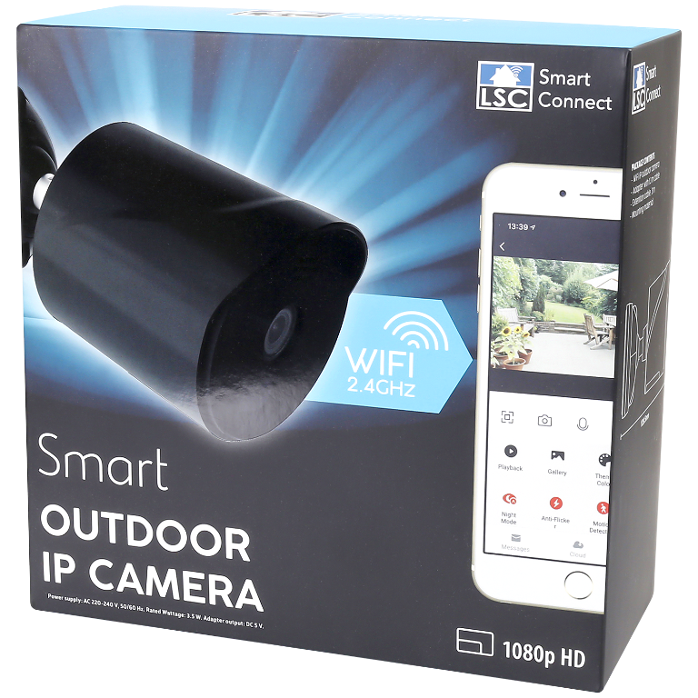
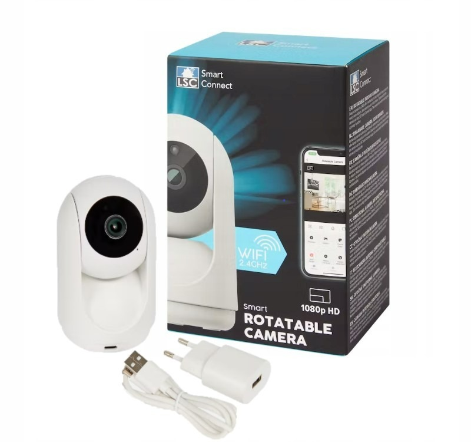

# LSC Camera  Root Toolkit

> ## Notes sur ce fork
>
> Fork de [`tasarren/lsc-tuya-toolkit`](https://github.com/tasarren/lsc-tuya-toolkit) adapté à une **autre caméra** que celle du dépôt
> d'origine : `IPC-XC-C323`, firmware **3.10.78.1269** (l'amont cible `6.2863.123`). Voir [`docs/CAMERA.md`](docs/CAMERA.md).
>
> Changements : config vidéo corrigée pour cette caméra (fin de la boucle de redémarrage), vidéo **1920×1080 à 20 fps** fluide,
> LED d'état éteinte. Les correctifs du firmware sont fournis sous forme de **scripts** (`tools/`) qui patchent votre propre copie ;
> aucun fichier du fabricant n'est publié.
>
> - [`docs/INSTALL.md`](docs/INSTALL.md) : **installeur** `install.py` (copie et personnalise la carte SD : Wi-Fi, IP fixe, heure, syslog, ONVIF, flux vidéo)
> - [`docs/CHANGES.md`](docs/CHANGES.md) : toutes les modifications, le déploiement, le retour arrière et le journal des actions
> - [`docs/CAMERA.md`](docs/CAMERA.md) : quelle caméra, et ce qui la distingue de l'amont
> - [`docs/WIFI_ET_IP.md`](docs/WIFI_ET_IP.md) : le Wi-Fi est configuré à deux endroits (pourquoi l'IP peut changer)
> - [`docs/HARDWARE.md`](docs/HARDWARE.md) et [`docs/SECURITY.md`](docs/SECURITY.md) : audits matériel et sécurité
>
> Ne publiez jamais votre `wifi.conf`, votre `_ak39_factory.ini` renseigné ni le dossier `logs/` (SSID et mot de passe en clair).

## What this fork adds (English summary)

Goal: run the camera **100% on the LAN, cloud disabled**. On top of the original toolkit, this fork provides:

- **Installer** (`install.py`, see [`docs/INSTALL.md`](docs/INSTALL.md)): copies and customizes the SD card (Wi-Fi, static IP, time, syslog, ONVIF, video stream).
- **Boot-loop fix** and smooth **1920x1080 @ 20 fps** video, status LED off, timezone/OSD clock fix (`TZ_STRING`).
- **Local MQTT gateway** (`md_inject.so`, preloaded into `anyka_ipc`) with automatic **Home Assistant discovery**: PTZ (relative, absolute, presets, save current position), day/night, privacy mode, lullabies (`lullaby/set` 1-5/stop), reboot button, SD health/usage. Topics: [`docs/TOPICS.md`](docs/TOPICS.md).
- **ONVIF** (PTZ, presets incl. `SetPreset`, privacy mode through relay output `RelayOutputToken_0`), see [`docs/ONVIF_MAPPING.md`](docs/ONVIF_MAPPING.md).
- **Persistence**: settings sent by MQTT/ONVIF are saved to `custom/state/settings.conf` and replayed after a reboot.
- **SD protection**: logs and PTZ state live in RAM; no writes to the system SD.
- **Home Assistant dashboards** generator: `tools/dashboards/gen_dashboards.py` (ONVIF and MQTT dashboards, examples in `docs/dashboards/`).
- Firmware findings from disassembly: [`docs/firmware/`](docs/firmware/), [`docs/EXPOSITION.md`](docs/EXPOSITION.md).

Never publish your `wifi.conf`, filled `_ak39_factory.ini`, `install.yaml` or the `logs/` folder.

This file documents the current firmware findings and a practical SD-card flow to boot custom scripts and keep local
services.

This findings belongs to version `6.2863.123` but it should work on any version, as long as you teak the config files.


Huge thanks to [guino/LSCOutdoor1080P](https://github.com/guino/LSCOutdoor1080P) because their findings allowed me to
create this toolkit.

If this project was useful to you, please consider supporting me.

[](https://ko-fi.com/tasarren)

## Key boot findings from the dump

- Boot chain: `init -> /etc/init.d/rcS -> /etc/init.d/rc.local -> /usr/sbin/main.sh`.
- `main.sh` launches `/tmp/service.sh start` (copied from `/usr/sbin/service.sh`).
- `service.sh` mounts TF card and checks marker files under `/mnt`.
- If `_ht_ap_mode.conf` exists, firmware copies `/mnt/hostapd` to `/tmp/hostapd` and wifi scripts execute it.
This is where we hijack the system. Because this is run before really starting the daemon/anyka_ipc, we can
modify the system, and then allow normal startup with poisoned scripts.
- If `_ht_get_log.conf` exists, firmware won't unmount our SD card from `/mnt` and will also dump debug logs into
  `/ht_log` folder 
- If `_ht_av_mode.conf` exists, an Audio/Video test will begin, booting up a FTP server to unknown purposes.
- If `ak39_factory.ini` exists, the system will boot in factory testing mode
 
This is the startup hijack point we keep using.

## SD payload layout

Use `sd_card/` as the SD card root content:

- `_ht_ap_mode.conf` - required marker to trigger custom `hostapd` execution.
- `_ak39_factory.ini` - required marker to trigger factory test mode.
- `hostapd` - launcher (executed by firmware; runs `hack.sh`).
- `hack.sh` - tiny bootstrap called by `hostapd`.
- `logs/` - persistent logs written to SD.
- `custom/` - all custom scripts/configs/binaries.

## Factory Testing Mode

On this firmware, an empty factory marker file enables a Factory Testing Mode 
with a ready to use RTSP server.

This is really all what you need if you only want a RTSP camera, without PTZ, just video.

- Create an empty `_ak39_factory.ini` on the SD root (this repo includes an empty
  `sd_card/_ak39_factory.ini`).
- Reboot.
- RTSP listens on port `554`.
- The working URL on this device is:

```
rtsp://CAMERA_IP:554/main_ch
```

> If you get `RTSP/1.0 454 Session Not Found` on `/videoMain`, try `/main_ch`.

Factory mode also plays loud startup prompt audio by default.
In this SD payload you can disable it with:

- `MUTE_FACTORY_PROMPT=1` in `sd_card/root_system/custom/configs/hack.conf`

### What `_ak39_factory.ini` actually is

From Ghidra analysis of `anyka_ipc`:

- Factory mode is detected by `access("/tmp/_ak39_factory.ini", 0)`.
- The file is parsed using `iniparser_load("/tmp/_ak39_factory.ini")`.
- The code looks up keys in the `section:key` form (iniparser style), e.g.:
    - `wifi_station:ssid`
    - `wifi_station:passphrase`
    - `wifi_station:ip`
    - `wifi_station:netmask`
    - `wifi_station:gateway`
    - `aging_test:aging_value`

Note: boot `service.sh` copies only the first 1024 bytes from SD (`dd ... bs=1024 count=1`), so keep this file small.

## Telnet
The Factory Test mode, enables a Telnet service by default on port 23, we inject `/etc/shadow` with `root` / `telnet`
But you can also enable an alternative userless telnet by switching `TELNET=1` in `sd_card/custom/configs/hack.conf`

## ONVIF

This firmware includes an ONVIF mini stack:

- `/usr/local/bin/mini_onvif_service.sh` starts `lighttpd`, `wsd_simple_server`, and `onvif_notify_server`.
- In the SD payload, set `ONVIF=1` in `sd_card/custom/configs/hack.conf` to start it.

Notes:

- ONVIF uses port `8080` on this firmware (lighttpd).
  ``- When `ONVIF=1`, the scripts write `logs/onvif_status.txt` on the SD card with process/port probes.
  ``

> You can also enable ONVIF with the stock Tuya APP by setting `bool_onvif_switch = 1` in `_ht_sw_settings.ini`

### Configuring ONVIF profiles

The ONVIF service uses `/usr/local/etc/onvif_simple_server.conf`.
In this SD payload we can override it (non-flash) via a bind mount:

- SD file: `sd_card/custom/configs/onvif_simple_server.conf`
- Mounted to: `/usr/local/etc/onvif_simple_server.conf`

### ONVIF PTZ helpers (SD-based)

Some firmware builds advertise PTZ via ONVIF but do not ship the expected helper commands in `/usr/local/bin`.

This payload provides replacements from SD:

- `/tmp/sd/custom/scripts/ptz_move`
- `/tmp/sd/custom/scripts/get_position`
- `/tmp/sd/custom/scripts/is_moving`
- `/tmp/sd/custom/scripts/ptz_presets.sh`

The PTZ wrappers call:

- `/tmp/sd/custom/bin/ptzctl`

`ptzctl` reads PTZ settings directly from:

- `sd_card/custom/configs/ptz.conf`

Key tuning fields in `ptz.conf`:

- `PAN_FD_ADDR`, `TILT_FD_ADDR`, `IOCTL_MOVE`
- `PAN_INVERT`, `TILT_INVERT`,
- `STEP_MULT`, `STEP_REPEAT`
- `DEBUG_LOG` (set `1` to write `ptz.log`, `0` to disable PTZ logging)

The ONVIF config points directly to these SD scripts when:

- `ONVIF=1`
- `ONVIF_PTZ=1`

If PTZ actions fail in clients (for example Home Assistant), check:

- `logs/ptz.log`

### Building `ptzctl`:

- `./build_ptzctl.sh`

Docker-based isolated ARM build (recommended):

- `./docker/build_binaries.sh`

This uses a containerized ARM GCC toolchain and copies built artifacts back with `docker cp`.

Default output path:

- `sd_card/custom/bin/ptzctl`

## Configuration-driven behavior

All custom behavior is controlled by `custom/configs/hack.conf` (strict shell `KEY=value`).

Important toggles:

- `DUMP_FORCE=1` forces dump to run again even if done flag exists.

## How to use (quick steps)

1. Format SD card as FAT32.
2. Tweak the config files in `sd_card/custom/configs/` folder.
3. Copy everything from `sd_card/` to SD root.
4. Boot camera with SD inserted.
5. Connect via telnet to `YOUR_IP:23` or `YOUR_IP:24` if you enable `TELNET=1` in `hack.conf` as an alternative Telnet service
6. Enjoy

### What does it do
1. Dumps the entire filesystem from your device into `sd_card/dumps` as a backup
2. Injects some payloads to prevent regular boot.
3. Creates `/etc/shadow` with an user `root` with password `telnet`
> You can create your own password replacing `sd_card/shadow` file
  
For normal behavior:

- Do not use the SD Card :)

## Wi-Fi setup from SD
You should use `sd_card/_ak39_factory.ini` to setup your Wi-Fi settings to allow Anyka IPC to set it up for you.
> You can leave ip, netmask and gateway blank to use DHCP

If you do not want to use this (whatever), ensure `_ak39_factory.ini` is empty and edit `sd_card/custom/configs/wifi.conf`.

This will start wpa_supplicant with the settings provided in `wifi.conf`

Notes:
- `WIFI_MODE=none` leaves networking unchanged (stock firmware manages it).
- The scripts use `wpa_supplicant` + `wpa_cli` via `/usr/sbin/station_connect.sh`.

## MQTT et Home Assistant (passerelle locale)

`md_inject.so` (chargé dans `anyka_ipc` via `LD_PRELOAD`) pilote la caméra sans cloud. Réglages dans `hack.conf` : `MOTION`, `MOTION_TOPIC`, `HA_DISCOVERY`, `HA_PREFIX`.

- **Commande** : `<base>/<fonction>/set` (le `/set` est obligatoire). **État** : `<base>/<fonction>`, retained. `<base>` = nom de la caméra.
- Les entités Home Assistant (30) sont créées automatiquement par la découverte MQTT à chaque connexion de la caméra au broker (`HA_DISCOVERY=0` pour désactiver).
- Les commandes sont exécutées l'une après l'autre : un déplacement PTZ ou le mode privé bloque les suivantes quelques secondes.
- Tableau complet des topics : [docs/TOPICS.md](docs/TOPICS.md). DP exposés ou non : [docs/EXPOSITION.md](docs/EXPOSITION.md).

Alias principaux :

| Topic `/set` | Valeurs | Effet |
|---|---|---|
| `night` | `auto` `day` `night` | mode jour/nuit |
| `privacy` | `ON` `OFF` | pose privée (mémorise puis restaure la position) |
| `ptz_move` | `up` `down` `left` `right` `stop` | déplacement manuel (1 s puis arrêt) |
| `ptz_absolute` | `x,y` de -1 à 1 | position absolue |
| `ptz_preset_goto` / `ptz_preset_delete` | n° | rappeler / supprimer un préréglage |
| `ptz_preset_save` | nom (`A-Za-z0-9_`) | enregistrer la position courante |
| `ptz_home` / `ptz_calibrate` | `ON` | recalage sur les butées / séquence de test (long) |
| `speaker_play` / `speaker_siren` | nom de fichier `.ulaw` ou `stop` / `ON` `OFF` | haut-parleur (attention au volume) |

Autres commandes : `reboot` (`ON`), `lullaby` (`1`..`5` ou `stop`). Les réglages posés par MQTT/ONVIF sont mémorisés dans `custom/state/settings.conf` et rejoués après un reboot (`scripts/persist.sh clear` pour les oublier).

### Tableaux de bord Home Assistant

`python3 tools/dashboards/gen_dashboards.py <nom> <base_mqtt> [dossier]` génère deux tableaux (YAML à coller dans l'éditeur brut) : `ha_dashboard_onvif_<nom>.yaml` (vidéo, déplacements et préréglages via l'intégration ONVIF, entité `camera.<nom>_profile_0`) et `ha_dashboard_mqtt_<nom>.yaml` (PTZ absolu et manuel, préréglages aller/enregistrer, mode privé, jour/nuit, berceuse 1 à 5, redémarrage, le tout par `mqtt.publish`). Exemples dans `docs/dashboards/`.

### Enregistrer la position actuelle en préréglage

1. Placer la caméra (boutons PTZ, `ptz_absolute` ou client ONVIF).
2. **MQTT / Home Assistant** : publier le nom sur `<base>/ptz_preset_save/set` (ex. `salon`, caractères `A-Za-z0-9_`) ou remplir l'entité « PTZ enregistrer le préréglage (nom) ». Le n° attribué est publié sur `<base>/ptz_preset_saved`, la liste sur `<base>/ptz_presets`.
3. **ONVIF** : appeler `SetPreset` (`ProfileToken`, `PresetName`) : par exemple `onvif.ptz` / un client comme ONVIF Device Manager (bouton « Set preset »).
4. Rappeler : `<base>/ptz_preset_goto/set` = n°, ou `GotoPreset` ; supprimer : `ptz_preset_delete/set` = n°, ou `RemovePreset`.
5. Le mode privé ONVIF : `SetRelayOutputState` relais 0 (`closed` = privé, `open` = normal).

États : `ptz_position`, `ptz_presets`, `sd_storage` (JSON en Kio), `sd_health` (`ON` = carte absente ou en lecture seule).

Résultats de test sur une caméra réelle (valeur envoyée, relue, puis restaurée) :

- **Fonctionnent** : `flip_onoff`, `watermark_onoff`, `night_vision_mode`, `basic_anti_flicker`, `object_outline_onoff`, `alarm_zone_onoff`, `alarm_sensitivity`, `alarm_function_onoff`, `human_filter`, `sound_detect_onoff`, `sound_sensitivity`, `cry_detect_onoff`, `track_enable`, `patrol_mode`, `blub_onoff`, `floodlight_lightness`, `pir_detect_switch`, `door_control`, `flight_warn_time`, `privacy`, `ptz_absolute`, `ptz_preset_*`.
- **Acceptées sans effet visible** : `light_onoff`, `flight_warn_onoff`. Les réglages `temp_*` (aucun capteur) et `door_control` (aucune porte) restent sur MQTT mais n'ont pas d'entité Home Assistant.
- **Sans lecture du firmware** (`patrol_switch`, `patrol_tmode`, `patrol_time`, `link_move`, `link_pos`) : la passerelle republie la dernière valeur commandée. Ce n'est pas une confirmation du firmware.
- **Notes issues du désassemblage** : `flip_onoff` est une rotation de 180° (`bool_rotate180`), il n'existe pas de miroir ni de rotation à 90° séparés ; `link_move` ne fait qu'un `printf` ; `door_control` appelle `ht_cardoor_ctrl` (porte probablement absente) ; les berceuses sont configurées mais le lecteur n'est pas vérifié.

## Protection de la carte SD

Les journaux et la position PTZ sont écrits en RAM (`/tmp/hacklogs`, `/tmp/ptzstate`), avec instantané périodique sur la SD (`LOG_TO_SD=1` pour revenir aux journaux sur la SD). `SD_SYNC=1` monte la SD en écriture synchrone. L'entité `sd_health` signale une carte en lecture seule. Voir [docs/CHANGES.md](docs/CHANGES.md) §32.

## Fuseau horaire

`TZ_STRING` (par défaut `CET-1CEST,M3.5.0,M10.5.0/3`, France, heure d'été automatique) est appliqué après le démarrage de `anyka_ipc`, qui décale sinon l'horloge de +8 h.

## Logs

By default, custom logs are written to RAM under `/tmp/hacklogs` (see "Protection de la carte SD"); set `LOG_TO_SD=1` to write them to the SD card under `SD_DIR/logs/` (where `SD_DIR` is `/tmp/sd` on-device).

# Tested with the following cameras:



(Pictures from [guino/LSCOutdoor1080P](https://github.com/guino/LSCOutdoor1080P).) This fork was also tested on an `IPC-XC-C323` (AK3918EV330, firmware `3.10.78.1269`).

Open an Issue or PR anytime.

If you used the Toolkit to dump your camera filesystem (you should have a dump/ directory on the SD card) and your firmware is not 6.2863.123, please share the dump (or a link) in this repo so we can add support for your version. If the dump contains secrets (Wi-Fi credentials/keys), remove them before uploading.
