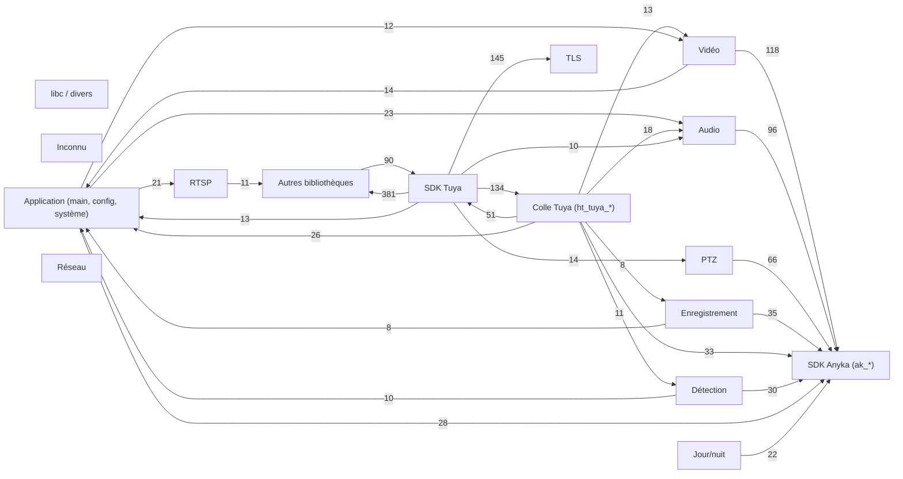

# Architecture de `anyka_ipc`

Généré par `tools/firmware/gen_reference.py` (voir `README.md` pour la méthode). Les nombres viennent de Ghidra 12.2 sur le binaire 3.10.78.1269.

## Groupes de fonctions

| Groupe | Fonctions | Taille (octets) |
|---|---|---|
| libc / divers | 3850 | 954217 |
| SDK Tuya | 1600 | 545832 |
| Inconnu | 1268 | 585212 |
| TLS | 539 | 177512 |
| SDK Anyka (ak_*) | 504 | 156924 |
| Autres bibliothèques | 389 | 156680 |
| RTSP | 146 | 89964 |
| Application (main, config, système) | 136 | 61116 |
| Colle Tuya (ht_tuya_*) | 85 | 20720 |
| Enregistrement | 53 | 27496 |
| Vidéo | 45 | 26072 |
| PTZ | 36 | 22968 |
| Audio | 34 | 12720 |
| Détection | 26 | 6776 |
| Jour/nuit | 25 | 10392 |
| Réseau | 24 | 13096 |

## Dépendances entre groupes

Une flèche A → B signifie que des fonctions de A appellent des fonctions de B ; le nombre est le nombre de liens d'appel (8 au minimum).

## Séquence de démarrage (`main`)

Ordre des appels dans `main` (désassemblage, hors fonctions utilitaires). Le service Tuya est lancé en dernier ; sans cloud, la caméra continue avec RTSP et le matériel.

```mermaid
flowchart TD
  main(["main"])
  ht_log_init["ht_log_init"]
  main --> ht_log_init
  ht_config_init["ht_config_init"]
  ht_log_init --> ht_config_init
  ht_device_id_init["ht_device_id_init"]
  ht_config_init --> ht_device_id_init
  ht_start_monitor["ht_start_monitor"]
  ht_device_id_init --> ht_start_monitor
  ak_ipc_get_version["ak_ipc_get_version"]
  ht_start_monitor --> ak_ipc_get_version
  ht_av_init["ht_av_init"]
  ak_ipc_get_version --> ht_av_init
  ht_config_get_int["ht_config_get_int"]
  ht_av_init --> ht_config_get_int
  ak_thread_create["ak_thread_create"]
  ht_config_get_int --> ak_thread_create
  ht_tuya_func_set_indicator_light["ht_tuya_func_set_indicator_light"]
  ak_thread_create --> ht_tuya_func_set_indicator_light
  ht_system_ctrl_init["ht_system_ctrl_init"]
  ht_tuya_func_set_indicator_light --> ht_system_ctrl_init
  ht_montion_detect_init["ht_montion_detect_init"]
  ht_system_ctrl_init --> ht_montion_detect_init
  ht_pir_detect_init["ht_pir_detect_init"]
  ht_montion_detect_init --> ht_pir_detect_init
  ht_night_mode_init["ht_night_mode_init"]
  ht_pir_detect_init --> ht_night_mode_init
  ht_system_set_reset_cb["ht_system_set_reset_cb"]
  ht_night_mode_init --> ht_system_set_reset_cb
  ht_audio_codec_start_encode["ht_audio_codec_start_encode"]
  ht_system_set_reset_cb --> ht_audio_codec_start_encode
  ht_network_init["ht_network_init"]
  ht_audio_codec_start_encode --> ht_network_init
  ht_audio_codec_play_audio_file["ht_audio_codec_play_audio_file"]
  ht_network_init --> ht_audio_codec_play_audio_file
  ht_factory_test_enter["ht_factory_test_enter"]
  ht_audio_codec_play_audio_file --> ht_factory_test_enter
  ht_factory_test_set_sys_version["ht_factory_test_set_sys_version"]
  ht_factory_test_enter --> ht_factory_test_set_sys_version
  ht_factory_test_set_check_id_cb["ht_factory_test_set_check_id_cb"]
  ht_factory_test_set_sys_version --> ht_factory_test_set_check_id_cb
  ht_network_get_connect_state["ht_network_get_connect_state"]
  ht_factory_test_set_check_id_cb --> ht_network_get_connect_state
  ht_sync_utc_time["ht_sync_utc_time"]
  ht_network_get_connect_state --> ht_sync_utc_time
  ht_set_timezone["ht_set_timezone"]
  ht_sync_utc_time --> ht_set_timezone
  SystemCall_msg["SystemCall_msg"]
  ht_set_timezone --> SystemCall_msg
  ht_rtsp_start["ht_rtsp_start"]
  SystemCall_msg --> ht_rtsp_start
  ht_record_init["ht_record_init"]
  ht_rtsp_start --> ht_record_init
```

## Threads et fonctions dont l'adresse est prise

Les fonctions qui créent un thread (`ak_thread_create`, `pthread_create`) et les fonctions dont elles prennent l'adresse (point d'entrée du thread ou callback).

| Créateur | Fonctions dont l'adresse est prise |
|---|---|
| `CreateAndStart` | `FUN_0022092c` |
| `FUN_00076198` | `FUN_00076098` |
| `FUN_0009e87c` | `FUN_0009e194` |
| `FUN_000ad7c0` | `FUN_000acea0` |
| `FUN_000b003c` | `FUN_000aef60` |
| `FUN_000c12cc` | `FUN_000c170c` |
| `FUN_000c2a24` | `FUN_000c12cc`, `ak_ao_get_handle_id` |
| `FUN_000c37fc` | `FUN_000c1104`, `sem_destroy`, `printf`, `sem_post`, `perror` |
| `FUN_000c45f0` | `FUN_000c4380`, `FUN_000c4864` |
| `FUN_000c4864` | `ak_print`, `FUN_000c4430`, `pthread_cancel`, `memset`, `ak_mem_alloc_`, `printf`, `isp_set_sensor_value`, `isp_cfg_file_store`, `ak_vpss_set_me_attr`, `isp_get_sensor_value`, `vi_dev_get_raw_data`, `ak_sleep_ms`, `ak_vi_release_frame`, `fopen`, `fseek`, `ftell` |
| `FUN_000eecc0` | `FUN_000ef370` |
| `FUN_000f46dc` | `FUN_000f2d64` |
| `FUN_001e9d10` | `FUN_001e2530`, `FUN_001e3484` |
| `FUN_0034f738` | — |
| `GetTStreamerInstance` | `StartStreaming`, `StopStreaming`, `PauseStreaming`, `ResumeStreaming`, `SetMediaSetting`, `RegisterCallBack`, `FillCloudGwSkills`, `FUN_001f6394`, `ThreadStreaming` |
| `IPC_APP_format_sd_card` | `FUN_00076198` |
| `IPC_APP_set_siren_onoff` | `FUN_000780e8` |
| `__p2p_v3_login_init` | `FUN_001e2f48`, `lan_p2p_frm_data_cb`, `FUN_001e6768`, `FUN_001e6644`, `tuya_p2p_rtc_auth`, `tuya_p2p_hw_aes_create`, `tuya_p2p_hw_aes_destroy`, `tuya_p2p_hw_aes_encrypt`, `tuya_p2p_hw_aes_decrypt`, `FUN_001e9d10` |
| `__ss_dl_start` | `__ss_download_task` |
| `__tuya_ipc_ss_init_real` | `__thread_stream_storage` |
| `ak_ai_start_capture` | `ak_thread_rwlock_wrlock`, `FUN_000e9904` |
| `ak_ats_start` | `FUN_000c37fc` |
| `ak_cb_thread_create` | — |
| `ak_its_start` | `FUN_000c45f0` |
| `ak_md_init` | `FUN_000c605c` |
| `ak_thread_create` | — |
| `ak_venc_open` | `memset`, `FUN_000d1724`, `FUN_000d16ec`, `ak_cb_dma_free`, `ak_cb_release_frame_buf`, `ak_cb_module_clock`, `ak_cb_module_reset`, `ak_cb_mutex_init`, `ak_cb_mutex_destroy`, `ak_cb_mutex_lock`, `ak_cb_mutex_unlock`, `ak_cb_sem_init`, `ak_cb_sem_destroy`, `ak_cb_sem_wait`, `ak_cb_irq_wait`, `ak_cb_atomic_increment`, `ak_cb_sem_post`, `ak_cb_thread_create`, `ak_cb_atomic_decrement`, `ak_mem_free`, `ak_cb_thread_join`, `ak_cb_thread_delete`, `AKV_Encoder_Init`, `snprintf`, `ak_thread_mutex_unlock`, `ak_thread_mutex_destroy`, `AKV_Encoder_Destroy` |
| `app_video_bind_vi_venc` | `ak_vi_get_dev_attr`, `ak_vi_get_chn_attr`, `memcpy`, `app_video_vi_stream_th` |
| `handleRecvData` | `FUN_000a3a04`, `FUN_000a39e0` |
| `ht_audio_codec_start_decode` | `FUN_0009ef38` |
| `ht_audio_codec_start_encode` | `FUN_0009e650` |
| `ht_factory_test_enter` | `FUN_000a6154`, `FUN_000a6b98` |
| `ht_montion_detect_init` | `FUN_000a7934` |
| `ht_night_mode_init` | `FUN_000aa7f0`, `FUN_000aaa48` |
| `ht_pir_detect_init` | `FUN_000abab0` |
| `ht_playback_start` | `FUN_00064e54` |
| `ht_ptz_calibration` | `FUN_000ae98c` |
| `ht_record_init` | `FUN_00069888` |
| `ht_rtsp_start` | `FUN_000b3c2c` |
| `ht_start_monitor` | `FUN_000a74ec` |
| `ht_system_ctrl_init` | `FUN_000b43fc` |
| `ht_thread_create` | — |
| `ht_tuya_baby_monitor_init` | `FUN_0006b5f4`, `FUN_0006bc28` |
| `ht_tuya_event_start` | `FUN_0006c934`, `FUN_0006d10c`, `ht_system_call_cb`, `FUN_0006d760`, `ht_tuya_event_md_cb`, `ht_tuya_event_sd_cb` |
| `ht_tuya_stream_storage_init` | `FUN_0006f3a8` |
| `ht_tuya_stream_storage_reinit` | `FUN_0006f3a8` |
| `ht_video_codec_auto_change_fps` | `FUN_000b6258` |
| `ht_video_codec_start_encode` | `FUN_000b64bc`, `FUN_000b7cdc`, `FUN_000b7474` |
| `ht_video_osd_init` | `ht_video_osd_th` |
| `ht_zoom_init` | `FUN_000b08e8` |
| `hwl_wf_sniffer_set` | `FUN_000822b8`, `thread_qrcode` |
| `ls_osa_thread_create` | — |
| `main` | `FUN_00071b98`, `ht_system_reset`, `ht_check_id_valid_cb` |
| `osal_timer_start` | `FUN_0012ac28` |
| `pthread_create` | — |
| `start_protect_license` | `server_run` |
| `tuya_ipc_cloud_storage_init` | `FUN_001d40d4`, `__thread_cloud_storage`, `FUN_001d423c` |
| `tuya_ipc_ss_init` | `__thread_disk_monitor`, `FUN_001ed6ec` |
| `tuya_ipc_ss_pb_start` | `FUN_001f26b0` |
| `tuya_ipc_tranfser_init` | `FUN_001e68e8`, `FUN_001e053c`, `FUN_001e003c` |
| `tuya_ipc_webrtc_create_session` | `tuya_ipc_webrtc_session_proc`, `__webrtc_session_detech` |
| `tuya_main` | `thread_live_video`, `thread_live_audio`, `thread_md_proc` |
| `tuya_p2p_rtc_init` | — |
| `uv_thread_create` | — |
