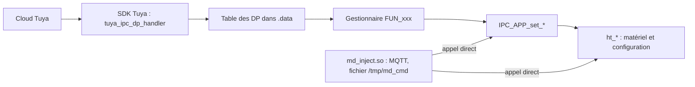
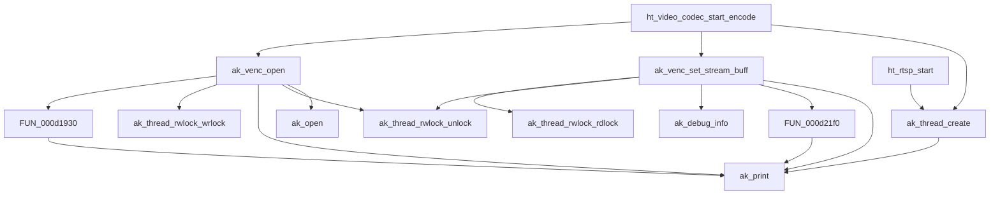
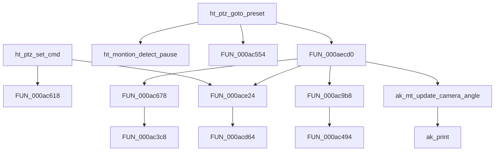
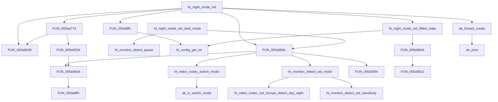
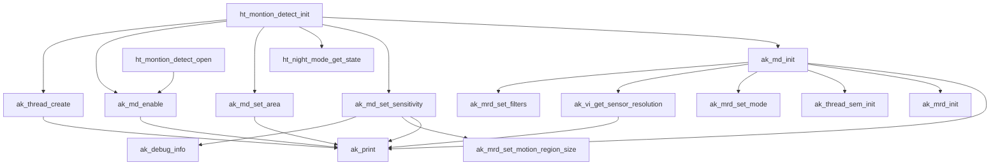
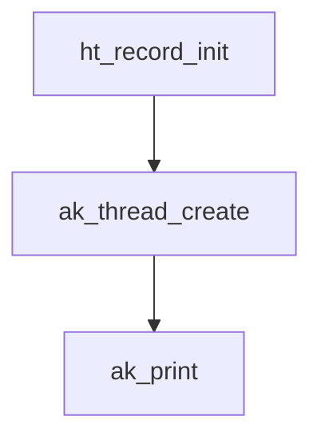
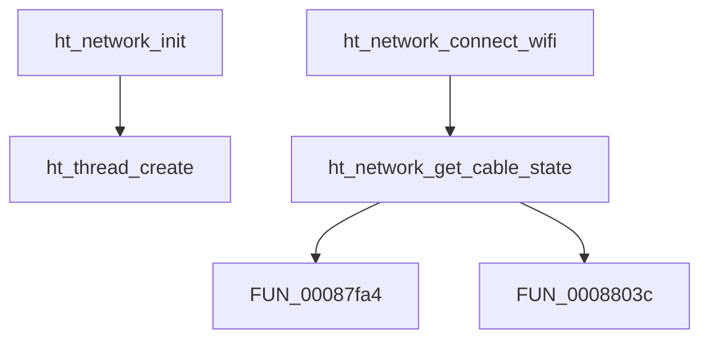
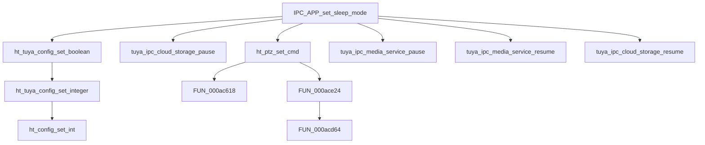

# Flux (diagrammes d'appels)

Généré par `tools/firmware/gen_reference.py`. Chaque diagramme part de fonctions connues et suit les **appels directs** (profondeur et nombre d'enfants limités ; les fonctions utilitaires sont masquées). Ce sont des **extraits**, pas le graphe complet (28 000 liens, voir `ghidra/calls.tsv` à régénérer). Les appels par pointeur de fonction n'y sont pas suivis, sauf via la table des DP (`DP_TABLE.md`).

## Chemin d'une commande cloud (DP) et chemin local

## Vidéo : capture, encodage, RTSP

## Audio : capture et lecture

```mermaid
flowchart TD
  ht_audio_codec_start_encode["ht_audio_codec_start_encode"]
  ak_aenc_open["ak_aenc_open"]
  ak_aenc_set_attr["ak_aenc_set_attr"]
  ak_thread_create["ak_thread_create"]
  ak_aenc_close["ak_aenc_close"]
  ht_audio_codec_start_decode["ht_audio_codec_start_decode"]
  ak_adec_open["ak_adec_open"]
  ak_adec_set_output_pcm_len["ak_adec_set_output_pcm_len"]
  ak_adec_close["ak_adec_close"]
  ak_thread_mutex_destroy["ak_thread_mutex_destroy"]
  ak_print["ak_print"]
  ak_thread_rwlock_wrlock["ak_thread_rwlock_wrlock"]
  ak_thread_rwlock_unlock["ak_thread_rwlock_unlock"]
  ak_get_os_timestamp["ak_get_os_timestamp"]
  ak_mem_alloc_["ak_mem_alloc_"]
  ak_thread_rwlock_rdlock["ak_thread_rwlock_rdlock"]
  FUN_000cc7a0["FUN_000cc7a0"]
  FUN_000cc7e0["FUN_000cc7e0"]
  FUN_000cc420["FUN_000cc420"]
  ak_mem_free["ak_mem_free"]
  FUN_000cee3c["FUN_000cee3c"]
  FUN_000cc348["FUN_000cc348"]
  ht_audio_codec_start_encode --> ak_aenc_open
  ht_audio_codec_start_encode --> ak_aenc_set_attr
  ht_audio_codec_start_encode --> ak_thread_create
  ht_audio_codec_start_encode --> ak_aenc_close
  ht_audio_codec_start_decode --> ak_adec_open
  ht_audio_codec_start_decode --> ak_adec_set_output_pcm_len
  ht_audio_codec_start_decode --> ak_thread_create
  ht_audio_codec_start_decode --> ak_adec_close
  ht_audio_codec_start_decode --> ak_thread_mutex_destroy
  ak_aenc_open --> ak_print
  ak_aenc_open --> ak_thread_rwlock_wrlock
  ak_aenc_open --> ak_thread_rwlock_unlock
  ak_aenc_open --> ak_get_os_timestamp
  ak_aenc_open --> ak_mem_alloc_
  ak_aenc_set_attr --> ak_thread_rwlock_rdlock
  ak_aenc_set_attr --> ak_thread_rwlock_unlock
  ak_aenc_set_attr --> ak_print
  ak_aenc_set_attr --> FUN_000cc7a0
  ak_thread_create --> ak_print
  ak_aenc_close --> ak_print
  ak_aenc_close --> ak_thread_rwlock_wrlock
  ak_aenc_close --> FUN_000cc7e0
  ak_aenc_close --> FUN_000cc420
  ak_aenc_close --> ak_mem_free
  ak_adec_open --> ak_print
  ak_adec_open --> ak_thread_rwlock_rdlock
  ak_adec_open --> ak_thread_rwlock_unlock
  ak_adec_open --> ak_get_os_timestamp
  ak_adec_open --> ak_mem_alloc_
  ak_adec_set_output_pcm_len --> ak_thread_rwlock_rdlock
  ak_adec_set_output_pcm_len --> ak_thread_rwlock_unlock
  ak_adec_set_output_pcm_len --> ak_thread_rwlock_wrlock
  ak_adec_set_output_pcm_len --> ak_mem_free
  ak_adec_set_output_pcm_len --> ak_get_os_timestamp
  ak_adec_close --> ak_thread_rwlock_wrlock
  ak_adec_close --> ak_print
  ak_adec_close --> FUN_000cee3c
  ak_adec_close --> ak_thread_mutex_destroy
  ak_adec_close --> ak_mem_free
  FUN_000cc7a0 --> ak_print
  FUN_000cc7e0 --> FUN_000cc348
  FUN_000cc7e0 --> ak_thread_mutex_destroy
  FUN_000cc7e0 --> ak_print
  FUN_000cee3c --> ak_mem_free
  FUN_000cee3c --> ak_print
```

## PTZ

## Jour/nuit

## Détection de mouvement

## Enregistrement SD

## Réseau et Wi-Fi

## Service Tuya (cloud)

```mermaid
flowchart TD
  ht_tuya_service_start["ht_tuya_service_start"]
  FUN_000709b4["FUN_000709b4"]
  ht_tuya_stream_storage_init["ht_tuya_stream_storage_init"]
  IPC_APP_Get_Mqtt_Status["IPC_APP_Get_Mqtt_Status"]
  IPC_APP_ptz_preset_sync["IPC_APP_ptz_preset_sync"]
  IPC_APP_Sync_Utc_Time["IPC_APP_Sync_Utc_Time"]
  TUYA_APP_Enable_P2PTransfer["TUYA_APP_Enable_P2PTransfer"]
  IPC_APP_upload_all_status["IPC_APP_upload_all_status"]
  IPC_APP_Init_SDK["IPC_APP_Init_SDK"]
  ht_tuya_av_capture_start["ht_tuya_av_capture_start"]
  IPC_APP_get_light_onoff["IPC_APP_get_light_onoff"]
  IPC_APP_set_light_onoff["IPC_APP_set_light_onoff"]
  IPC_APP_get_flip_onoff["IPC_APP_get_flip_onoff"]
  IPC_APP_set_flip_onoff["IPC_APP_set_flip_onoff"]
  IPC_APP_get_basic_anti_flicker["IPC_APP_get_basic_anti_flicker"]
  ak_thread_create["ak_thread_create"]
  tuya_ipc_preset_get["tuya_ipc_preset_get"]
  tuya_ipc_preset_del["tuya_ipc_preset_del"]
  tuya_ipc_get_service_time["tuya_ipc_get_service_time"]
  tuya_ipc_check_in_dls["tuya_ipc_check_in_dls"]
  tuya_ipc_tranfser_init["tuya_ipc_tranfser_init"]
  IPC_APP_get_sleep_mode["IPC_APP_get_sleep_mode"]
  FUN_0007a374["FUN_0007a374"]
  IPC_APP_get_watermark_onoff["IPC_APP_get_watermark_onoff"]
  IPC_APP_get_night_mode["IPC_APP_get_night_mode"]
  FUN_0007a3b8["FUN_0007a3b8"]
  ht_tuya_service_start --> FUN_000709b4
  ht_tuya_service_start --> ht_tuya_stream_storage_init
  ht_tuya_service_start --> IPC_APP_Get_Mqtt_Status
  ht_tuya_service_start --> IPC_APP_ptz_preset_sync
  ht_tuya_service_start --> IPC_APP_Sync_Utc_Time
  ht_tuya_service_start --> TUYA_APP_Enable_P2PTransfer
  ht_tuya_service_start --> IPC_APP_upload_all_status
  FUN_000709b4 --> IPC_APP_Init_SDK
  FUN_000709b4 --> ht_tuya_av_capture_start
  FUN_000709b4 --> IPC_APP_get_light_onoff
  FUN_000709b4 --> IPC_APP_set_light_onoff
  FUN_000709b4 --> IPC_APP_get_flip_onoff
  FUN_000709b4 --> IPC_APP_set_flip_onoff
  FUN_000709b4 --> IPC_APP_get_basic_anti_flicker
  ht_tuya_stream_storage_init --> ak_thread_create
  IPC_APP_ptz_preset_sync --> tuya_ipc_preset_get
  IPC_APP_ptz_preset_sync --> tuya_ipc_preset_del
  IPC_APP_Sync_Utc_Time --> tuya_ipc_get_service_time
  IPC_APP_Sync_Utc_Time --> tuya_ipc_check_in_dls
  TUYA_APP_Enable_P2PTransfer --> tuya_ipc_tranfser_init
  IPC_APP_upload_all_status --> IPC_APP_get_sleep_mode
  IPC_APP_upload_all_status --> FUN_0007a374
  IPC_APP_upload_all_status --> IPC_APP_get_light_onoff
  IPC_APP_upload_all_status --> IPC_APP_get_flip_onoff
  IPC_APP_upload_all_status --> IPC_APP_get_watermark_onoff
  IPC_APP_upload_all_status --> IPC_APP_get_night_mode
  IPC_APP_upload_all_status --> FUN_0007a3b8
```

## Privacy / veille

